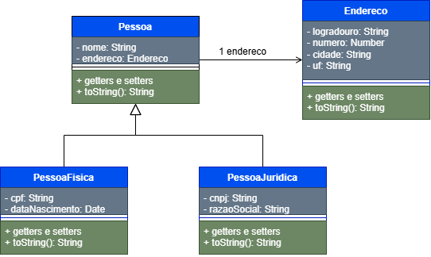

# Cadastro de Clientes da Electronic

Cadastro de pessoas físicas e jurídicas, sempre com endereço, feito com Programação Orientada a Objetos em JavaScript.

**Estudante:** Alexandre Neves
**Turma:** program_orientada_obj_desfll_t01rn
**Repositório:** [github.com/pagedotcom/cadastro-eletronic](https://github.com/pagedotcom/cadastro-eletronic)
## Estrutura do projeto

- `index.js`: cenários de teste
- `src/`: classes (`Endereco`, `Pessoa`, `PessoaFisica`, `PessoaJuridica`) e funções de validação (`validacoes.js`)
- `docs/`: diagrama de classes (`.drawio` e `.png`) e a saída dos testes (`saida.txt`)

 
## Como executar

```bash
node index.js
```

## Diagrama de classes



- `Pessoa` é a classe base (nome e endereço).
- `PessoaFisica` e `PessoaJuridica` herdam de `Pessoa`.
- `Pessoa` possui um `Endereco`.
- Os campos são privados (`#`) e acessados por getters e setters.

## Validações

- **Nome:** ao menos 3 caracteres
- **CPF:** 11 dígitos
- **Data de nascimento:** data válida e não futura
- **CNPJ:** 14 dígitos
- **Razão social:** obrigatória

Valores inválidos lançam erro com `throw` e são tratados com `try/catch`.

## Testes

Saída do comando `node index.js`:

```text
[1. Pessoa física válida]
OK   -> Silvana Lima | Rua Dino Bueno, 1000 - São Paulo/SP | CPF: 52998224725 | Nasc.: 1995-08-20

[2. Pessoa jurídica válida]
OK   -> Mega Eletro | Av. Paulista, 1000 - São Paulo/SP | CNPJ: 11222333000181 | Razão social: Mega Eletro Comércio Ltda

[3. Pessoa física inválida (nome curto)]
ERRO -> Nome deve ter ao menos 3 caractere(s)

[4. Pessoa jurídica inválida (CNPJ curto)]
ERRO -> CNPJ deve ter 14 dígitos

[5. Pessoa física inválida (data futura)]
ERRO -> Data de nascimento inválida

[6. Pessoa jurídica inválida (razão social vazia)]
ERRO -> Razão social deve ter ao menos 1 caractere(s)
```

